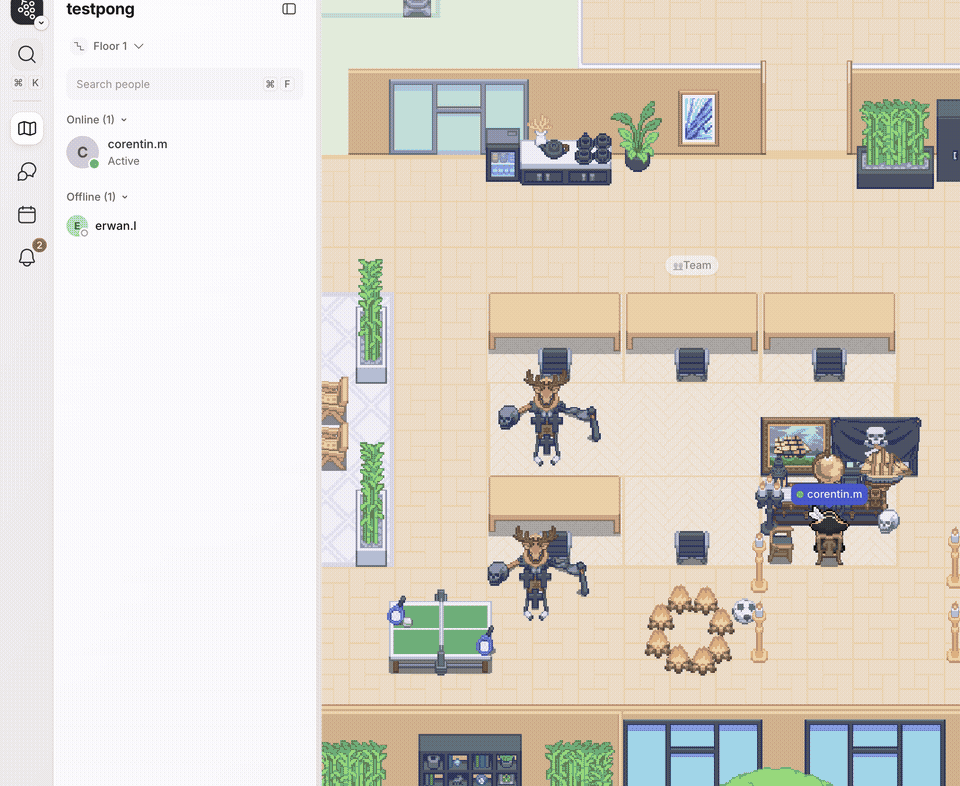
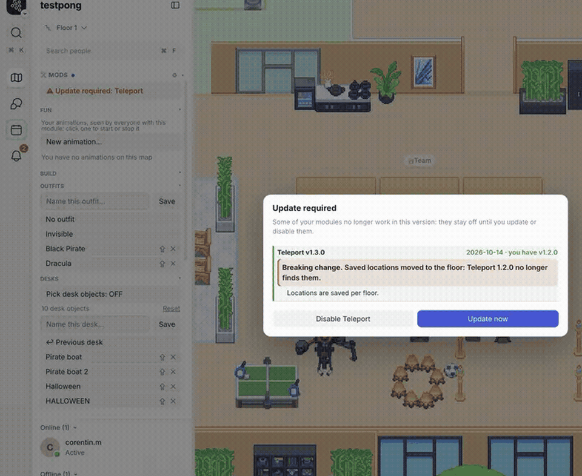
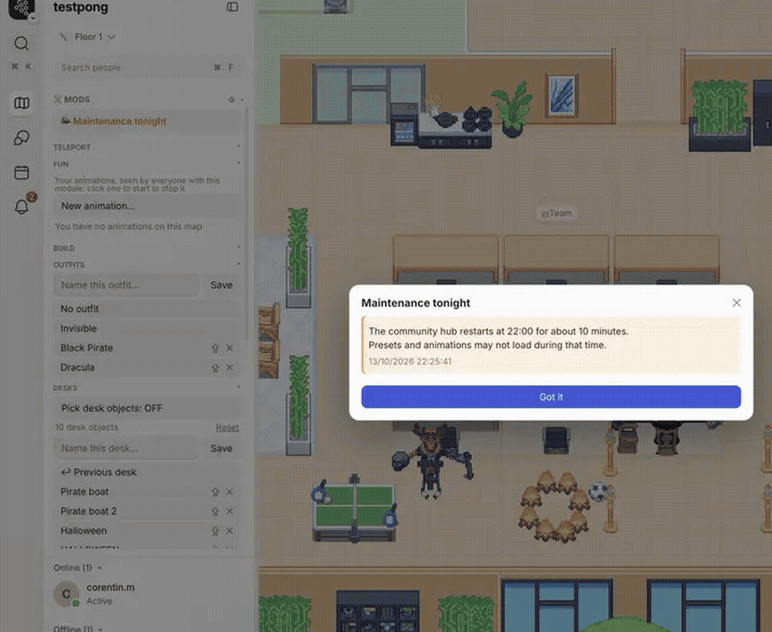
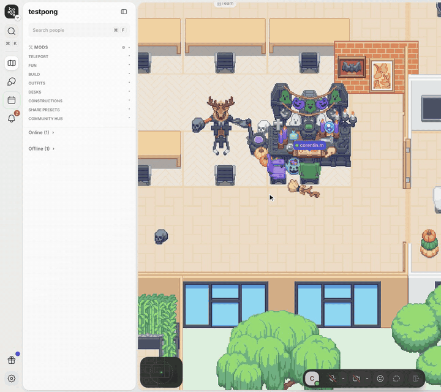
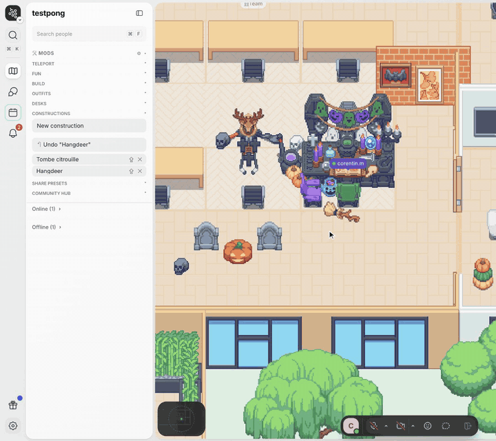
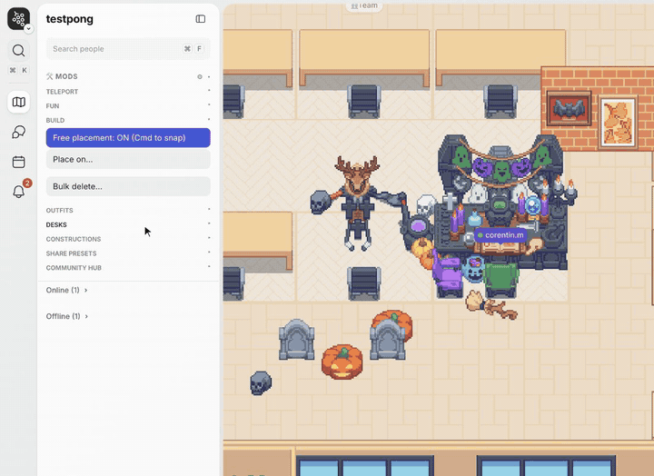
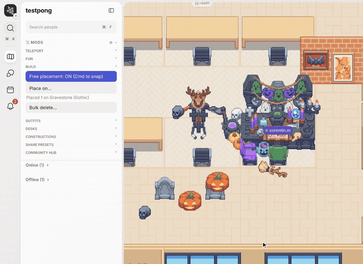
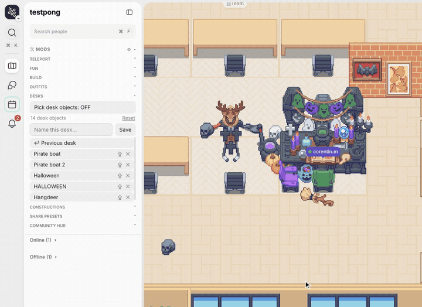
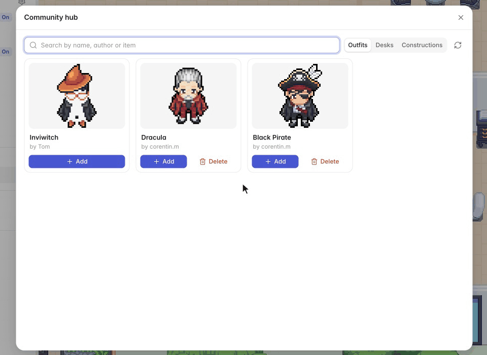
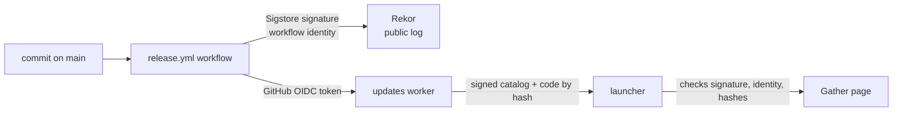

# Gather Mod Menu

A mod for [Gather V2](https://app.v2.gather.town) that adds a **Mods** panel at the top of the sidebar. It is split into modules: install only the features you want, and only their code runs in Gather and gets updated.

## Modules

| Module             | What it does                                                                                                                                                                                                                                                                                                                                                                                                                                                                                                                                                                       |
| ------------------ | ---------------------------------------------------------------------------------------------------------------------------------------------------------------------------------------------------------------------------------------------------------------------------------------------------------------------------------------------------------------------------------------------------------------------------------------------------------------------------------------------------------------------------------------------------------------------------------- |
| **Teleport**       | Teleport mode (every “Go to” and double-click teleports), TP to your desk, TP to a player, saved locations.                                                                                                                                                                                                                                                                                                                                                                                                                                                                        |
| **Fun**            | Gimmicks. Flee mode: keep your distance from a chosen player. Animations: select objects, pick a movement (orbit around a point, back and forth in a straight line, back and forth along a wave), click the point on the map, adjust with a live preview, save. Everyone on the map who has this module sees them, in sync (stored on the community hub, refreshed every minute). The list only shows yours: click one to start or stop it for everyone. Nothing is sent to Gather's server: objects only move on screen, and the map is redrawn at 30 fps at most while one runs. |
| **Build**          | Free placement in the build tool (nothing snaps to tiles; hold Cmd to snap), “Place on…” to put objects on any other object, even ones Gather refuses (they are recreated as children of the support and render in front of it), and bulk delete (selection outlined in red; what sits on an object goes with it).                                                                                                                                                                                                                                                                 |
| **Outfits**        | Save and apply outfits, with built-in “No outfit” and “Invisible” (bowtie only).                                                                                                                                                                                                                                                                                                                                                                                                                                                                                                   |
| **Desks**          | Save and apply your desk decoration (only differing objects are removed/added), pick which objects belong to your desk, automatic “↩ Previous desk” backup.                                                                                                                                                                                                                                                                                                                                                                                                                        |
| **Constructions**  | Reusable groups of objects. “New construction”, select objects (what sits on them comes along), name, Save. To place one: click it, a ghost follows the pointer, click on the map (snapped to tiles unless free placement is on; Esc to cancel). “↶ Delete last” removes the objects of the last construction placed on this map.                                                                                                                                                                                                                                                  |
| **Placed objects** | Journal of everything the mod placed on the current map (constructions, desk presets, Place on…), kept across reloads: hover an entry to outline its objects in red, delete the last placement, any entry, or all of them. Keeps the last 200 placements / 5,000 objects.                                                                                                                                                                                                                                                                                                          |
| **Share presets**  | Export/import the presets of your installed modules as JSON.                                                                                                                                                                                                                                                                                                                                                                                                                                                                                                                       |
| **Community hub**  | Browse, preview, add and publish outfits, desks and constructions shared by others. Tabs follow your installed modules.                                                                                                                                                                                                                                                                                                                                                                                                                                                            |

Shared code lives in internal libraries (map helpers, map picking, previews, placements journal, job queue, hub API), installed automatically when a module needs them.

Fun (animations) and Community hub sign in to the hub with your Gather account: the mod reads Gather's ID token from the page and sends it once to the hub, which verifies it with Google's public keys and keeps only your Gather account id (not the token, not your email). What you publish belongs to that account, so you can manage it from the Gather app and the browser alike.

**Install reports**: on first install and after each update, the core sends the hub a random install id (kept in `localStorage`, one per Gather app or browser), whether the launcher is used, the installed module versions and your Gather ID token, verified the same way; the hub keeps your Gather account id with the report. Nothing else is sent, and nothing in between.

What the mod tracks on the map (animations, placed objects, your desk objects, saved locations) survives a new version of the map published by a space admin: Gather then recreates every object with a new id but keeps its `hashIdentifier`, so the mod finds objects by that, or by type and position, and follows the map if it moved. Animations belong to the floor, not to a map version.

Selecting objects on the map (Place on…, Bulk delete…, Pick desk objects, New construction, New animation): click to add/remove an object, or drag a box to toggle every object fully inside it (unselected ones are added, selected ones removed). Scroll to cycle through stacked objects, Esc to cancel.

Map edits never make you wait: placing constructions, Place on…, bulk delete and deletions from Placed objects are queued and run one after the other, in click order (the status shows how many are queued). Picking another desk while one is being applied stops it and applies the new one.

Every preset shows a preview on hover; the light/dark theme follows Gather. Click a section title to fold it; the panel scrolls past 60% of the screen height.

**Settings** (⚙ in the panel header):

- **Modules**: install/uninstall each module (uninstalling keeps its data). Every module has a **Changelog** link, installed or not. Turning on a module you don't have asks first, with its version, latest changes and the libraries it brings. Modules with several features (Teleport, Fun, Build) list them under their row: click one to hide it from the panel and turn it off (e.g. Flee mode). Modules published after you last opened the settings show a green **New** badge; they are never installed automatically. A module being uninstalled, or no longer published (**Removed** badge, with an **Uninstall** button), is shown in red.
- **What's new**: only what matters: updates not installed yet and the latest version of modules you don't have (green), and the changes of the last update installed for each module, in Gather's accent color (“installed”) until its next update. “Show full history” unfolds every other changelog entry. Changes starting with `Removed:` are shown in red.
- **Updates**: launcher status, last check, latest release (commit and date), pending updates, automatic updates on/off, “Check now” and “Review & install”, which shows each module's changelog next to the exact code diff before installing.

A dot in the panel header means updates or new modules are available.

**Mod news**: important changes (a breaking change, something to redo) open a “Mod news” window once, when you open Gather or when an update brings them: for installed modules, and for their pending updates (with “Review & install”). They also stand out in the changelogs. A fresh install starts with every past news item marked as read.



**Required updates**: a changelog entry marked `"breaking": true` is the minimum version of its module. Below it, the module stays off and an “Update required” window, which only closes through its buttons, offers to update it now (launcher) or to disable it, with the modules that depend on it. When the core itself is outdated, the whole mod stays off until you update it or turn it off for this session. The hub also knows these minimum versions: mods from Core 1.4.0 send their running versions with every hub request, and the hub answers `426` with the breaking changes they miss, which opens the same window (even without the launcher, whose catalog is the one of the pasted bundle).



**Announcements**: the author can send a message to every user (maintenance, incident, new feature) from the community hub (`npm run announce` in [gather-mod-hub](https://github.com/Trukl/gather-mod-hub#announcements)). The core checks every 10 minutes: a new announcement opens a window once, and active ones stay at the top of the Mods panel until they expire (click one to read it again).



## Demos

### Modules

Install only the modules you want from ⚙ Settings; “What's new” lists their changelog.



### Constructions

Select objects (click or drag a box), save them as a construction, then place it anywhere in one click. “↶ Delete last” removes the last placement (the recording shows its former name, “↶ Undo”).



### Place on…

Select the objects, pick the support, “Place here”: they are recreated on top of it and render in front of it.



### Bulk delete

Drag a box over objects (outlined in red), then delete them all.



### Desks

Hover a preset to preview it, click to apply it (only differing objects change), “↩ Previous desk” to go back.



### Community hub

Presets shared by others, one tab per installed preset module, with search.



## Install (GatherV2 desktop app, macOS)

Requirements: `/Applications/GatherV2.app` and Node.js ≥ 22.9.

```bash
git clone https://github.com/Trukl/gather-mod-menu.git
cd gather-mod-menu
npm ci --omit=dev
node scripts/build-launcher-app.mjs
```

The script creates `~/Applications/Gather Mods.app` (with Gather's icon). Open Gather **through this app** instead of GatherV2:

1. GatherV2 is (re)started with the debug port `31337`; if it was running without it, it is quit and restarted.
2. The launcher downloads the signed module catalog, **verifies its signature** (see “Update security”), downloads the code of your modules (checked against the catalog hashes), caches it and injects it into Gather on every page load. On the first run every module is installed; change that in ⚙ Settings.
3. Every 15 minutes it checks for new module versions. Automatic updates are **off by default**: updates are announced (dot in the panel header) and “Review & install” shows the diff before installing them live. When on, updates of your installed modules are installed as soon as they are detected. Settings live in `~/Library/Application Support/gather-mods/settings.json` (`autoUpdate`, `modules`).
4. It exits when Gather closes (or when Gather's debug port stays unreachable for 30 seconds). If it is no longer running, ⚙ Settings says so in red and disables the module and update settings until you reopen “Gather Mods.app”.

Opening the app again just brings Gather to the front. Logs: `~/Library/Logs/gather-mods-launcher.log`.

> While Gather runs with the debug port, any local program can drive the Gather session (the port only listens on `127.0.0.1`).

If Gather is opened normally (Dock, login item), the mod is not loaded.

### Without the launcher (browser)

Paste the content of `gather-mod-menu.js` (all modules in one file) into the DevTools console of an `app.v2.gather.town` tab. Pick your modules in ⚙ Settings. No automatic updates in this mode.

### Launcher environment variables

| Variable                      | Default                          | Purpose               |
| ----------------------------- | -------------------------------- | --------------------- |
| `GATHER_MODS_PORT`            | `31337`                          | GatherV2 debug port   |
| `GATHER_MODS_UPDATE_CHECK_MS` | `900000`                         | Update check interval |
| `GATHER_MODS_UPDATES_URL`     | `gather-mod-menu-updates` worker | Release source        |

## Development

```
src/core.js               core: module registry, panel, settings, launcher bridge
src/lib/*.js              internal libraries (map, map-pick, previews)
src/modules/*.js          modules
modules.json              module catalog: metadata, version, dependencies, changelog
gather-mod-menu.js        all modules in one file (generated by `npm run bundle`)
launcher/                 desktop launcher (Node, depends on sigstore)
scripts/release.mjs       catalog checks, signing and upload (run by the CI)
scripts/build-launcher-app.mjs   builds “Gather Mods.app”
updates/                  Cloudflare worker: GET /catalog, GET /modules/:hash, POST /release (CI only)
.github/workflows/release.yml    release workflow
docs/media/               README recordings
```

A module is a file that calls `window.__gatherMods.define(id, (ctx) => { … })`. `ctx` gives engine helpers, `ctx.section({ title, html, mount })` for its panel section, `ctx.use(id)` for libraries and other modules, `ctx.onCleanup` for uninstall, and `ctx.registerPresetType` to plug presets into Share and the hub. Modules are listed in `modules.json` in load order (core first, dependencies before dependents); `requires` maps each dependency to its minimum version.

The community hub (shared presets API) lives in a separate repo, `gather-mod-hub`.

## Releasing (maintainer)

1. Change the code of one or more modules, bump their `version` in `modules.json` and add a changelog entry (in English) for that version. Start a change with `Removed:` when it takes something away, so it shows in red. For news every user must read (breaking change, action needed), add a short `"notice"` (300 characters max) to that changelog entry: it opens the “Mod news” window once. When older versions of the module no longer work (new data format, changed hub API), also add `"breaking": true` to that entry: every install below that version must update or disable the module. Keep it for real breakages: it stops every outdated install at once.
2. `npm run bundle`, commit on a branch and open a pull request: `main` only accepts pull requests. Merging it publishes: the `Release mod` GitHub workflow runs on every push to `main` that touches `src/`, `modules.json` or the bundle, then creates a [GitHub release](https://github.com/Trukl/gather-mod-menu/releases) listing the changed modules and their changelog. Follow it with `gh run watch`; retry a failed run with `gh run rerun <id>`.

`npm run release:dry-run` runs the same workflow on `main` without publishing; the signed release is available as a workflow artifact.

The release is refused (red run, nothing published) when the bundle is out of date, a module's code changed without a higher version, a version changed without code change, a version goes backwards, or a changelog entry is missing. A push where no module changed publishes nothing. No signing key exists locally: only the CI publishes.

## Update security



- **Signature**: the workflow signs the catalog (commit, and for each module its metadata, version, changelog and code SHA-256) with [Sigstore](https://www.sigstore.dev): an ephemeral certificate issued for the workflow identity, no key to keep. Every signature is recorded in the public Rekor log, so no release can be published without a dated trace (the log holds the repo name, workflow and commit, not the code).
- **Launcher checks**: it only accepts a valid signature whose certificate was issued to `Trukl/gather-mod-menu/.github/workflows/release.yml@refs/heads/main`, refuses a catalog that downgrades a module, and only runs module code whose SHA-256 matches the signed catalog. Anything else is refused and the cached modules keep running.
- **Upload**: `POST /release` only accepts the OIDC token of that same workflow (repo and owner checked by id, `main` branch), a catalog whose commit matches the token, code matching the hashes, and versions that follow the rules above. No Cloudflare secret is stored in GitHub.
- **Review**: with automatic updates off, the changelog (written by the author) and the exact code diff (the proof) are shown before installing.

Limit: whoever can merge into `main` can publish. Each release is a public commit and a GitHub release, so the diff shown in “Review & install” can be compared with the code on GitHub.

Deploy the updates worker (after changing `updates/`): `npm run deploy-updates`.
