<p align="center"></p>

<h1 align="center">Gather Mod Menu</h1>

<p align="center">
A <b>Mods</b> panel for <a href="https://app.v2.gather.town">Gather V2</a>: teleport, animate the map, place your own images, save and share desks and constructions, and more.<br>
Install only the modules you want: only their code runs in Gather, and they update themselves from signed releases.
</p>

<p align="center">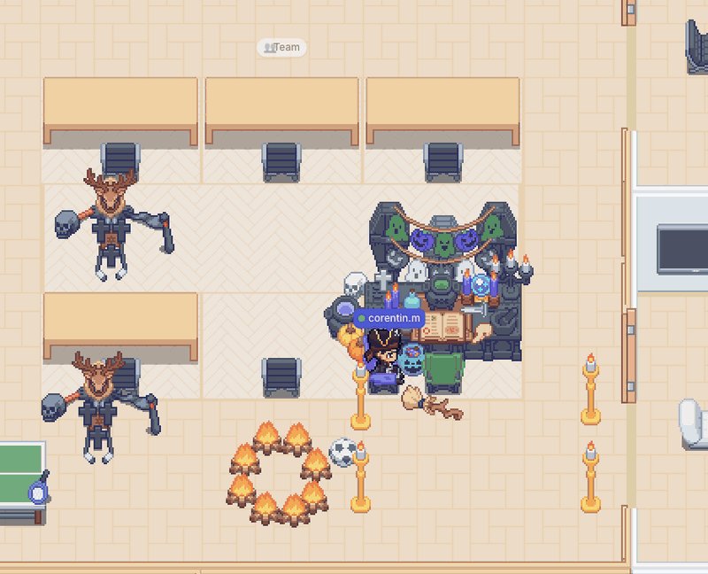</p>

**Contents**: [Install](#install) · [Modules](#modules) · [Using the panel](#using-the-panel) · [Your data](#your-data) · [Development](#development) · [Contributing](#how-to-contribute) · [Releasing](#releasing-maintainer) · [Update security](#update-security)

## Install

### Desktop app (macOS)

You need `/Applications/GatherV2.app` and Node.js ≥ 22.9.

```bash
git clone https://github.com/Trukl/gather-mod-menu.git
cd gather-mod-menu
npm ci --omit=dev
node scripts/build-launcher-app.mjs
```

This creates `~/Applications/Gather Mods.app`. From now on, **open Gather through this app** instead of GatherV2: it starts Gather with the mod. Opened normally (Dock, login item), Gather runs without the mod.

**Update the app** (new launcher version, new icon):

```bash
cd gather-mod-menu
git pull && npm ci --omit=dev && node scripts/build-launcher-app.mjs
```

Then quit Gather and reopen it with “Gather Mods.app”. Modules don't need this: they update from inside Gather.

<details>
<summary>What the launcher does</summary>

1. GatherV2 is (re)started with the debug port `31337`; if it was running without it, it is quit and restarted.
2. The launcher downloads the signed module catalog, **verifies its signature** (see [Update security](#update-security)), downloads the code of your modules (checked against the catalog hashes), caches it and injects it into Gather on every page load. On the first run every module is installed; change that in ⚙ Settings.
3. Every 15 minutes it checks for new module versions. Automatic updates are **off by default**: updates are announced (dot in the panel header) and “Review & install” shows the diff before installing them live. When on, updates of your installed modules are installed as soon as they are detected. Settings live in `~/Library/Application Support/gather-mods/settings.json` (`autoUpdate`, `modules`).
4. It exits when Gather closes (or when Gather's debug port stays unreachable for 30 seconds). If it is no longer running, ⚙ Settings says so in red and disables the module and update settings until you reopen “Gather Mods.app”.

Opening the app again just brings Gather to the front. Logs: `~/Library/Logs/gather-mods-launcher.log`. The app icon is `launcher/icon.png`, built into `launcher/icon.icns`.

> While Gather runs with the debug port, any local program can drive the Gather session (the port only listens on `127.0.0.1`).

| Environment variable          | Default                          | Purpose               |
| ----------------------------- | -------------------------------- | --------------------- |
| `GATHER_MODS_PORT`            | `31337`                          | GatherV2 debug port   |
| `GATHER_MODS_UPDATE_CHECK_MS` | `900000`                         | Update check interval |
| `GATHER_MODS_UPDATES_URL`     | `gather-mod-menu-updates` worker | Release source        |

</details>

### Browser (without the launcher)

Paste the content of [`gather-mod-menu.js`](gather-mod-menu.js) (all modules in one file) into the DevTools console of an `app.v2.gather.town` tab, then pick your modules in ⚙ Settings. No automatic updates in this mode: paste the latest file again to update.

## Modules

| Module                              | What you get                                                      |
| ----------------------------------- | ----------------------------------------------------------------- |
| [Teleport](#teleport)               | Teleport instead of walking: to your desk, a player, a saved spot |
| [Fun](#fun)                         | Flee a player; animate map objects, seen by everyone              |
| [Build](#build)                     | Free placement, Place on…, linked objects, bulk delete            |
| [Outfits](#outfits)                 | Saved outfits, plus “No outfit” and “Invisible”                   |
| [Desks](#desks)                     | Desk decoration presets, with an automatic backup                 |
| [Constructions](#constructions)     | Reusable groups of objects, placed in one click                   |
| [Placed objects](#placed-objects)   | Journal of what the mod placed, to delete it again                |
| [Share presets](#share-presets)     | Export and import your presets as JSON                            |
| [Community hub](#community-hub)     | Outfits, desks and constructions shared by others                 |
| [Custom objects](#custom-objects)   | Your own images on the map, seen by everyone                      |
| [Auto away](#auto-away)             | Away or Busy when you leave your computer, back when you return   |
| [Seasonal themes](#seasonal-themes) | Halloween, Christmas and Easter looks for Gather and its objects  |

Shared code lives in internal libraries (map helpers, map picking, previews, placements journal, job queue, hub API, path animation math), installed automatically when a module needs them.

### Teleport

- **Teleport mode**: every “Go to” and double-click teleports instead of walking.
- **TP to my desk** and **TP to a player**.
- **Saved locations**: name a spot, come back to it in one click.

### Fun

**Flee mode**: click a player to keep your distance from them; click again to stop.

**Animations** make map objects move, in sync for everyone on the map who has this module.

- **Animation studio**: a floating window. Select objects, then click points on the map: each point is a step, drawn as a dashed path with numbered points you can drag.
- **Each step** has a shape (line, wave, arc, orbit around a point, or your own `x(t)` and `y(t)` formulas), an easing (smooth, overshoot, bounce, elastic, or your own `f(t)`), a duration, a pause and a turn. The arrow buttons reorder steps, the copy button duplicates one.
- **Block or each**: the selection moves as one block, turning as one piece around its center, or each object on its own, one after the other with a stagger.
- **At the end** the path loops, plays back (ping-pong) or stops. Preview with play, pause and a timeline, then save.
- **Your animations**: click one to start or stop it for everyone; the pencil (on hover) edits it in the studio (the preview replaces it until you save).
- **Others' animations** are listed with their author: the eye button hides one on your screen only.

Animations are stored on the community hub (10 per account on a floor) and refreshed every minute. Nothing is sent to Gather's server: objects only move on screen. While one runs, the map is redrawn at 30 fps when Gather's window has the focus, 7 fps when it shows without the focus (like Gather itself), and not at all when it is hidden or minimized; animated custom images follow the same rule.

<details>
<summary>Reorder and duplicate steps, hide others' animations</summary>

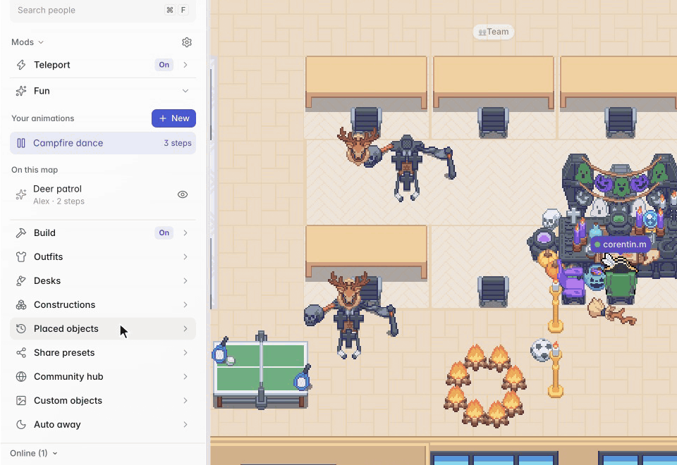

</details>

### Build

- **Free placement** in the build tool: nothing snaps to tiles (hold Cmd to snap).
- **Place on…**: put objects on any other object, even ones Gather refuses. They are recreated as children of the support and render in front of it.
- **Show linked objects…**: see what sits on what (Place on…, but also Gather's tables and shelves). Supports are outlined in green, objects on them in cyan, each joined to its support; hover says what an object is on, click one to see only its group.
- **Bulk delete**: drag a box over objects (outlined in red), then delete them all. What sits on an object goes with it.


<details>
<summary>Linked objects and bulk delete</summary>

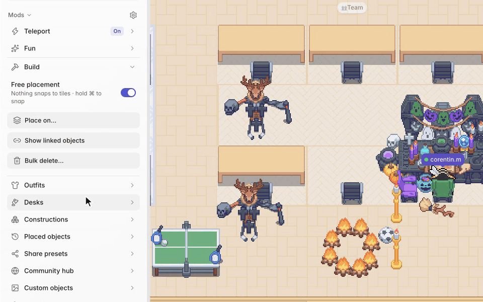


</details>

### Outfits

Save and apply outfits, with built-in “No outfit” and “Invisible” (bowtie only).

### Desks

- Save and apply your desk decoration: only differing objects are removed or added.
- Pick which objects belong to your desk.
- Hover a preset to preview it, click to apply it; picking another one while a desk is being applied stops it and applies the new one.
- “Previous desk” goes back to the automatic backup.


### Constructions

- **New**: select objects (what sits on them comes along), name it, save.
- **Place it**: click it, a ghost follows the pointer, click on the map (snapped to tiles unless free placement is on; Esc to cancel).
- **Remove last** removes the objects of the last construction placed on this map.


### Placed objects

A journal of everything the mod placed on the current map (constructions, desk presets, Place on…), kept across reloads. Hover an entry to outline its objects in red; delete the last placement, any entry, or all of them. It keeps the last 200 placements / 5,000 objects.

### Share presets

Export and import the presets of your installed modules as JSON.

### Community hub

Browse, preview, add and publish outfits, desks and constructions shared by others: one switch per installed preset type, with search.


### Custom objects

Your own images on the map, since Gather V2 cannot add custom objects. Everyone on the map who has this module sees them.

- **New image**: an https image URL or an upload (png/jpeg/gif/webp, 512 KB max, stored on the community hub), dropped where you click (it follows the pointer). Set its width and height in tiles, its layer (floor: under everyone; sorted: avatars standing above its base line pass behind it, below it in front; above everything), opacity and collision (the tiles from the base line down block avatars). Each account places 30 images at most per floor. Images are loaded without cookies nor referrer, and those over 8 MB or 16 megapixels are not shown.
- **Restyle**: an image drawn over a real object, which keeps its collision and seats, and follows it when it is animated.
- **The copy button** places copies like a Gather object: the ghost follows the pointer and every click places one more (for a restyle, every clicked object gets the image). Esc to stop.
- **Plane**: “Back” and “Front” move the image behind or in front of the objects it overlaps, one at a time (the object it is set against is outlined in green); “Reset” goes back to its layer, or to the restyled object's plane.
- **Animated GIFs** (and animated WebP or PNG) play on the map, in sync for everyone, for images and restyles alike.
- Placed images behave like map objects: Fun animates them and Bulk delete deletes them. They are hidden in Gather's simplified view, like the map's own objects.
- **Your images** are listed: hover one to see it outlined in red on the map; the pencil and trash buttons (on hover) edit or delete it.

Nothing is sent to Gather's server: people without the module see the map as it is, and collisions only stop the avatars of people who have it.

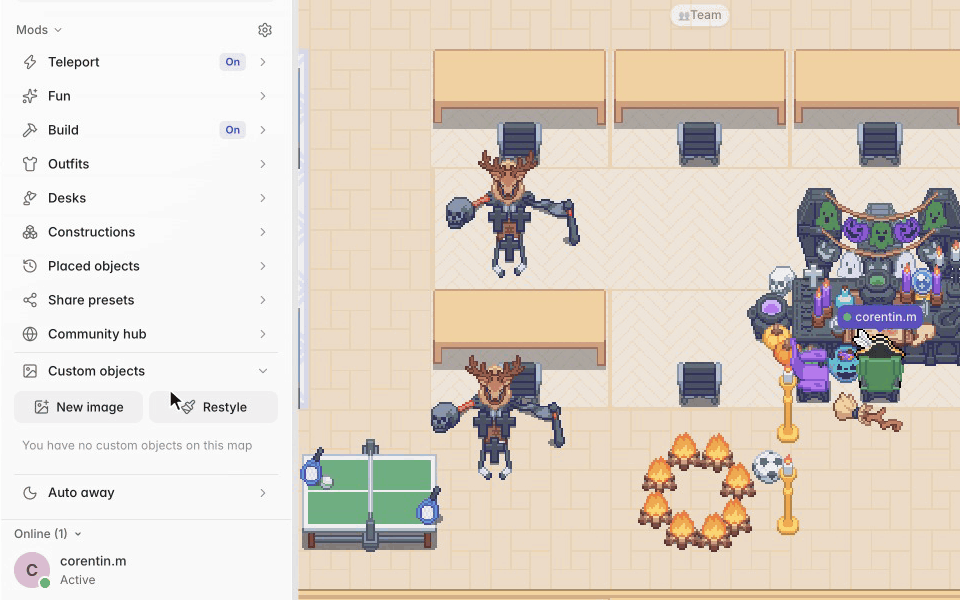

<details>
<summary>Plane, copies, animated GIFs, hover outline, simplified view</summary>

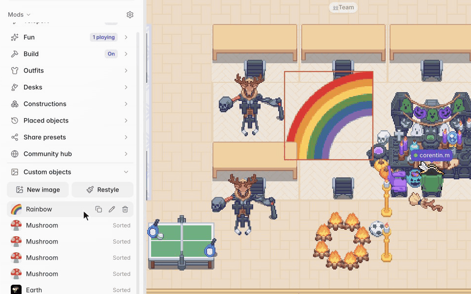

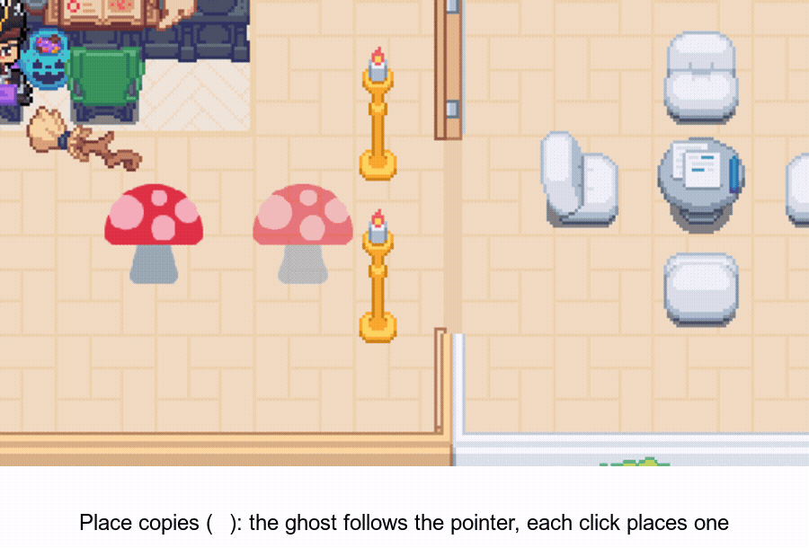

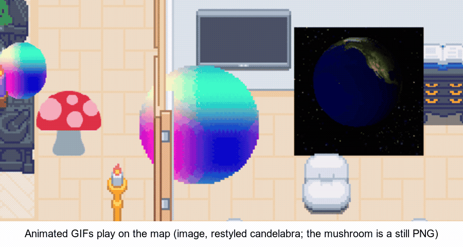

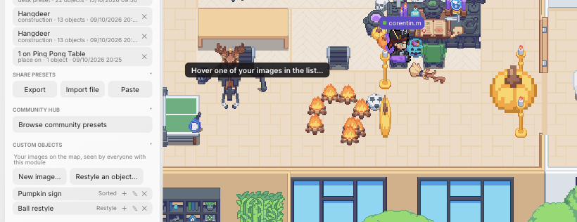

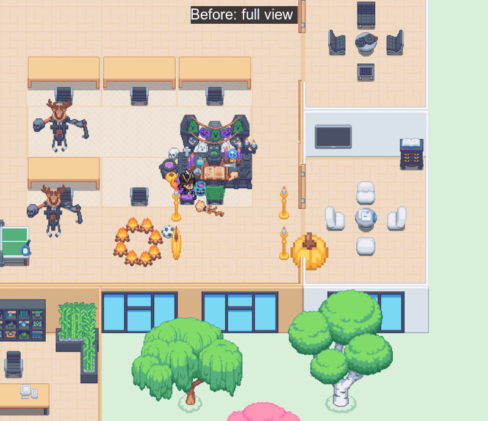

</details>

### Auto away

- After 5 minutes (1 to 120) without keyboard or mouse anywhere on your computer, your status goes to **Away** or **Busy** (your choice), and back to what it was as soon as you use the computer again.
- **A conversation or meeting in Gather counts as activity**: you are never set Away or Busy during one, and the minutes start when it ends.
- The same status set by hand is never changed, and a status you pick meanwhile wins.
- **Gather desktop app only**: it gives the computer's idle time, while a browser tab only sees its own page.

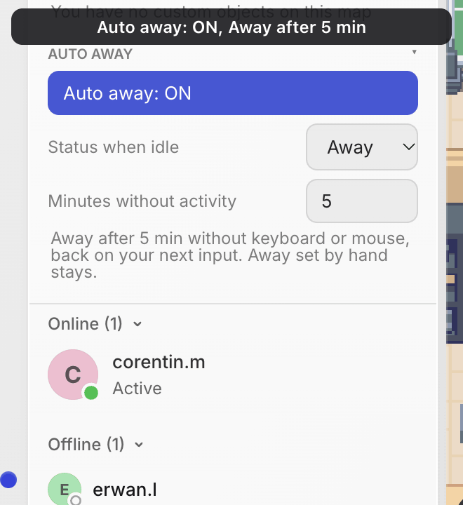

<sub>Recorded in a browser tab with the computer's idle time simulated.</sub>

### Seasonal themes

Halloween, Christmas and Easter looks, only on your screen, each on by itself during its season:

| Theme     | Season                                                   |
| --------- | -------------------------------------------------------- |
| Halloween | Oct 1 – Nov 15                                           |
| Christmas | Dec 1 – Jan 15                                           |
| Easter    | From three weeks before Easter Sunday to two weeks after |

What a theme changes:

- **Interface**: Gather's colors and buttons take the season's accent (pumpkin orange, Christmas red, Easter lilac) and its logo becomes a pumpkin, a snowy logo or a bunny.
- **Every catalog object**, decorated in your browser from Gather's own images, so new objects follow: autumn leaves, night windows and cobwebs for Halloween; snow on top, ornaments and frosted windows for Christmas; pastels, flowers and Easter eggs for Easter.
- **Over the map**: purple dusk, fog and bats; falling snow; drifting petals.

The switch in the panel turns the season's theme off: Gather's usual look comes back until the next season, which turns on again. Outside these dates there is no theme to turn on. Walls, floors, avatars and custom objects keep their look, under the map effects.

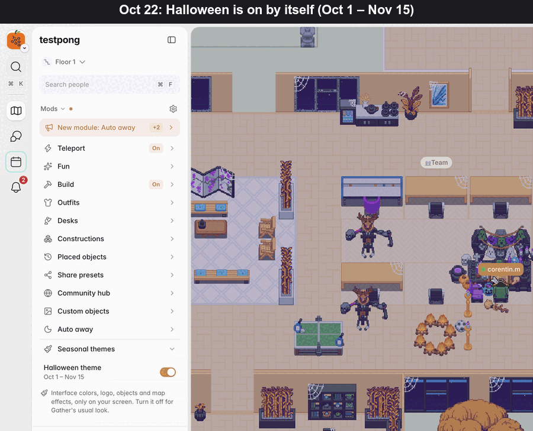

## Using the panel

**Install only what you want** from ⚙ Settings; “What's new” lists the changelogs.

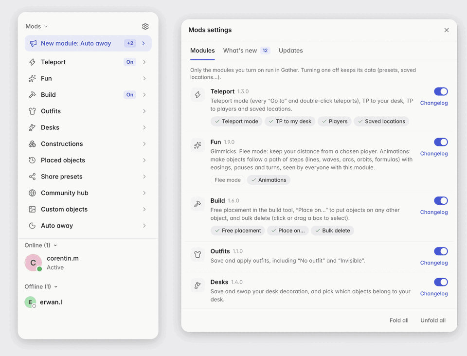

- **Selecting objects on the map** (Place on…, Bulk delete…, Pick desk objects, a new construction or animation, Restyle): click to add or remove an object, or drag a box to toggle every object fully inside it (unselected ones are added, selected ones removed). Scroll to cycle through stacked objects, Esc to cancel.
- **Map edits never make you wait**: placing constructions, Place on…, bulk delete and deletions from Placed objects are queued and run one after the other, in click order (the status shows how many are queued).
- Every preset shows a preview on hover, and the light/dark theme follows Gather. Click a section title to fold it: a folded section shows what is running (“On”, “Picking”, “2 playing”…). The panel scrolls past 60% of the screen height. It lives in the map tab's sidebar: back on the map from another tab (chat, calendar…), it is there right away, as you left it.
- **Who runs the mod**: players running the mod get a halo under their avatar, in Gather's accent color (so it follows [Seasonal themes](#seasonal-themes)), and a puzzle piece after their name, on the map and in the people list. Turn off “Show that I use the mod” at the top of ⚙ Settings → Modules to hide yours; you still see the others.

### Settings

Open them with ⚙ in the panel header. A dot there means updates or new modules are available.

- **Modules**: install or uninstall each module (uninstalling keeps its data). Every module has a **Changelog** link, installed or not. Turning on a module you don't have asks first, with its version, latest changes and the libraries it brings. Modules with several features (Teleport, Fun, Build) list them as chips under their row: click one to hide it from the panel and turn it off (e.g. Flee mode). A new module you don't have offers itself once in a window, with its description, the libraries it brings and an **Install** button; modules are never installed without your click. A module being uninstalled, or no longer published (**Removed** badge, with an **Uninstall** button), is shown in red.
- **What's new**: updates not installed yet (“Update available”), the latest version of modules you don't have (“Not installed”), and the changes of the last update installed for each module (“Installed”) until its next update; the tab counts them. “Show full history” unfolds every other changelog entry. Changes starting with `Removed:` are shown in red.
- **Updates**: launcher status, last check, latest release (commit and date), pending updates, automatic updates on/off, “Check now” and “Review & install”, which shows each module's changelog next to the exact code diff before installing.

### News, required updates and announcements

- **Mod news**: important changes (a breaking change, something to redo) open a “Mod news” window once, when you open Gather or when an update brings them: for installed modules, and for their pending updates (with “Review & install”). They also stand out in the changelogs. A fresh install starts with every past news item marked as read.
- **Required updates**: a changelog entry marked `"breaking": true` is the minimum version of its module. Below it, the module stays off and an “Update required” window, which only closes through its buttons, offers to update it now (launcher) or to disable it, with the modules that depend on it. When the core itself is outdated, the whole mod stays off until you update it or turn it off for this session. The hub also knows these minimum versions: mods from Core 1.4.0 send their running versions with every hub request, and the hub answers `426` with the breaking changes they miss, which opens the same window (even without the launcher, whose catalog is the one of the pasted bundle).
- **Announcements**: the author can send a message to every user (maintenance, incident, new feature) from the community hub (`npm run announce` in [gather-mod-hub](https://github.com/Trukl/gather-mod-hub#announcements)). The core checks every 10 minutes: a new announcement opens a window once, and active ones show as a card at the top of the Mods panel until they expire (click it to read them again, one after the other).

<details>
<summary>Recordings</summary>


</details>

## Your data

- **Sign-in**: the core signs in to the hub with your Gather account, for Fun (animations), Custom objects, Community hub, install reports and presence. The mod reads Gather's ID token from the page and sends it once to the hub (`/auth`, and nowhere else), which verifies it with Google's public keys, keeps only your Gather account id (not the token, not your email) and answers a hub session that every other request carries. The hub address can't be changed, except for a local test hub (`http://localhost`). What you publish belongs to that account, so you can manage it from the Gather app and the browser alike.
- **Install reports**: on first install and after each update, the core sends the hub a random install id (kept in `localStorage`, one per Gather app or browser), whether the launcher is used and the installed module versions, with the hub session; the hub keeps your Gather account id with the report. Nothing else is sent, and nothing in between.
- **Presence**: while the mod runs, the core sends the hub, every 2 minutes, with the hub session (the hub keeps your account id and the time), the account ids of the space's online players; the hub answers which of them ran the mod in the last 5 minutes. With “Show that I use the mod” off, the hub deletes your record instead, so nobody sees your halo.
- **New map versions**: what the mod tracks on the map (animations, placed objects, your desk objects, saved locations, custom images) survives a new version of the map published by a space admin. Gather then recreates every object with a new id but keeps its `hashIdentifier`, so the mod finds objects by that, or by type and position, and follows the map if it moved. Saved locations keep the nearest object as an anchor; custom images keep objects spread over the map and move by what most of them moved. Animations belong to the floor, not to a map version.

## Development

```
src/core.js               core: module registry, panel, settings, launcher bridge
src/lib/*.js              internal libraries (map, map-pick, motion, previews…)
src/modules/*.js          modules
modules.json              module catalog: metadata, version, dependencies, changelog
gather-mod-menu.js        all modules in one file (generated on main by the Bundle workflow)
launcher/                 desktop launcher (Node, depends on sigstore) and app icon
scripts/release.mjs       catalog checks, signing and upload (run by the CI)
scripts/check.mjs         pull request check (`npm run check`)
scripts/build-launcher-app.mjs   builds “Gather Mods.app”
updates/                  Cloudflare worker: GET /catalog, GET /modules/:hash, POST /release (CI only)
.github/workflows/        check.yml (pull requests), bundle.yml (main), release.yml (after each bundle, or by hand)
docs/media/               README recordings
```

A module is a file that calls `window.__gatherMods.define(id, (ctx) => { … })`. `ctx` gives engine helpers, `ctx.section({ title, html, mount, status })` for its panel section (`status()` returns a short text such as “On”, shown while the section is folded), `ctx.use(id)` for libraries and other modules, `ctx.onCleanup` for uninstall, and `ctx.registerPresetType` to plug presets into Share and the hub. Modules are listed in `modules.json` in load order (core first, dependencies before dependents); `requires` maps each dependency to its minimum version, and `icon` names the [Lucide](https://lucide.dev/icons) icon of the module in the panel and the settings.

The core ships the UI kit, so the mod looks like Gather: elements a module adds to the page call `ctx.applyTheme(el)` (light or dark tokens `--gm-*`), use its classes (`gm-btn`, `gm-toggle` with a `gm-switch`, `gm-field`, `gm-seg`, `gm-list` / `gm-item`, `gm-note`, `gm-window`…), and draw icons with `<i class="gm-i" data-i="name"></i>`. The icons are Lucide paths listed in `src/core.js`; add the ones a new module needs there.

The community hub (presets, animations and custom objects API) lives in a separate repo, [gather-mod-hub](https://github.com/Trukl/gather-mod-hub).

## How to contribute

The repo is public but only maintainers can push to it: contribute through a fork.

1. Fork the repo on GitHub (“Fork”, or `gh repo fork Trukl/gather-mod-menu --clone`), then create a branch.
2. Make your change. For module code, also bump the module's `version` in `modules.json` and add a changelog entry (see [Releasing](#releasing-maintainer)). Leave `gather-mod-menu.js` out: it is generated on `main` after the merge, so pull requests never conflict on it.
3. Test it: `npm run bundle`, then paste `gather-mod-menu.js` into the DevTools console of an `app.v2.gather.town` tab (see [Browser](#browser-without-the-launcher)). Before committing, `git checkout gather-mod-menu.js` drops the generated file.
4. Push the branch to your fork and open a pull request against `main`, with a GIF or video of the change when it shows on screen.

The `Check` workflow runs on every pull request (`npm run check` runs it locally): `modules.json` is valid, every module whose code changed has a higher version with its changelog entry, the code parses, and the bundle is left out. A maintainer reviews and merges it, which releases it.

Changes to the community hub (shared presets, animations, custom objects API) go to [gather-mod-hub](https://github.com/Trukl/gather-mod-hub), the same way.

## Releasing (maintainer)

1. Change the code of one or more modules, bump their `version` in `modules.json` and add a changelog entry (in English) for that version.
   - Start a change with `Removed:` when it takes something away, so it shows in red.
   - For news every user must read (breaking change, action needed), add a short `"notice"` (300 characters max) to that changelog entry: it opens the “Mod news” window once.
   - When older versions of the module no longer work (new data format, changed hub API), also add `"breaking": true` to that entry: every install below that version must update or disable the module. Keep it for real breakages: it stops every outdated install at once.
2. Commit on a branch and open a pull request: `main` only accepts pull requests, once the `Check` workflow passes.
3. Merge it. The `Bundle` workflow regenerates `gather-mod-menu.js` on `main`, then the `Release mod` workflow signs and publishes the modules that changed and creates a [GitHub release](https://github.com/Trukl/gather-mod-menu/releases) listing them with their changelog. Merges in a row are released one after the other. `npm run release` (or “Run workflow” on `Release mod`) runs it by hand; retry a failed run with `gh run rerun <id>`.

`npm run release:dry-run` runs the same workflow on `main` without publishing; the signed release is available as a workflow artifact.

The release is refused (red run, nothing published) when the bundle is out of date (the `Bundle` workflow hasn't finished yet), a module's code changed without a higher version, a version changed without code change, a version goes backwards, or a changelog entry is missing. When no module changed, it publishes nothing and stops without error. No signing key exists locally: only the CI publishes.

## Update security

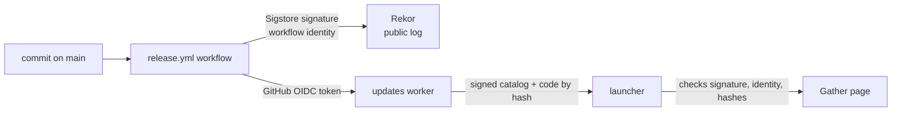

- **Signature**: the workflow signs the catalog (commit, and for each module its metadata, version, changelog and code SHA-256) with [Sigstore](https://www.sigstore.dev): an ephemeral certificate issued for the workflow identity, no key to keep. Every signature is recorded in the public Rekor log, so no release can be published without a dated trace (the log holds the repo name, workflow and commit, not the code).
- **Launcher checks**: it only accepts a valid signature whose certificate was issued to `Trukl/gather-mod-menu/.github/workflows/release.yml@refs/heads/main`, refuses a catalog that downgrades a module, and only runs module code whose SHA-256 matches the signed catalog. Anything else is refused and the cached modules keep running.
- **Upload**: `POST /release` only accepts the OIDC token of that same workflow (repo and owner checked by id, `main` branch), a catalog whose commit matches the token, code matching the hashes, and versions that follow the rules above. No Cloudflare secret is stored in GitHub.
- **Review**: with automatic updates off, the changelog (written by the author) and the exact code diff (the proof) are shown before installing.

Limit: whoever can merge into `main` can publish. Each release is a public commit and a GitHub release, so the diff shown in “Review & install” can be compared with the code on GitHub. The `Bundle` workflow is the only one allowed to push to `main` without a pull request, with a deploy key: it only commits the regenerated `gather-mod-menu.js`, which the launcher never runs (it runs the signed modules).

Deploy the updates worker (after changing `updates/`): `npm run deploy-updates`.
